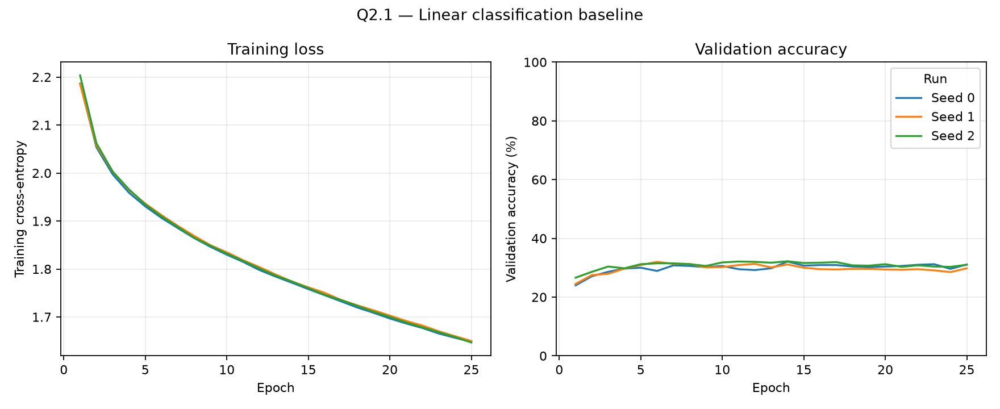
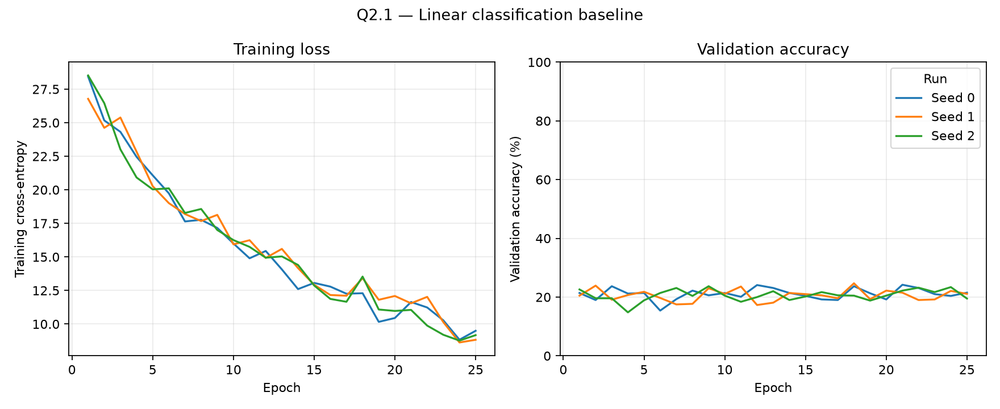

# Q2.1 — Baseline linear

## Estado

Esta nota regista a configuração e os resultados da regressão logística multinomial. A baseline principal usa `lr=0.001`, selecionado após a experiência controlada abaixo. Os valores vêm de `summary.json`; a execução é reproduzível com `python src/run_q2_1.py --learning-rate 0.001` a partir da raiz do repositório.

## Dados e pré-processamento

| Split | Imagens | Distribuição por classe |
|---|---:|---:|
| Treino | 6 500 | 650 em cada uma das 10 classes |
| Validação | 1 000 | 100 em cada classe |
| Teste | 1 000 | 100 em cada classe |

As imagens RGB de `64 × 64` são achatadas em vetores de 12 288 valores. Os canais são normalizados com média e desvio-padrão calculados exclusivamente no conjunto de treino:

| Canal | Média | Desvio-padrão |
|---|---:|---:|
| R | 0.46338 | 0.25846 |
| G | 0.45295 | 0.25710 |
| B | 0.41729 | 0.27130 |

## Modelo e treino

O classificador é uma camada linear `Linear(12 288, 10)`, equivalente a regressão logística multinomial, com **122 890 parâmetros treináveis** (122 880 pesos e 10 biases). Foi treinado com cross-entropy, SGD, learning rate `0.001`, batch size `128` e 25 épocas. Seeds: `0`, `1` e `2`. Em cada execução, o checkpoint escolhido é o da melhor accuracy de validação; o conjunto de teste só é avaliado depois dessa seleção.

## Resultados atuais

Accuracy reportada em percentagem; média e desvio-padrão amostral entre as três seeds.

| Seed | Melhor época | Validação no melhor checkpoint | Teste no melhor checkpoint |
|---:|---:|---:|---:|
| 0 | 14 | 32.10% | 27.70% |
| 1 | 6 | 32.00% | 25.90% |
| 2 | 14 | 32.20% | 26.60% |
| **Média ± desvio-padrão** | — | **32.10% ± 0.10 pp** | **26.73% ± 0.91 pp** |

O desempenho no teste excede a referência uniforme (`10%` para 10 classes). A loss de treino diminui e a accuracy de validação melhora inicialmente, atingindo o máximo entre as épocas 6 e 14 conforme a seed; depois oscila. O checkpoint selecionado é sempre o de maior accuracy de validação.

### Experiência controlada: learning rate

Mantivemos arquitetura, batch size, épocas, normalização, SGD e seeds iguais, alterando apenas o learning rate.

| Learning rate | Validação, média ± desvio-padrão | Teste, média ± desvio-padrão |
|---:|---:|---:|
| 0.1 | 24.20% ± 0.50 pp | 20.83% ± 0.87 pp |
| **0.001** | **32.10% ± 0.10 pp** | **26.73% ± 0.91 pp** |

O valor `0.001` aumentou a accuracy observada em **7.90 pontos percentuais** na validação e **5.90 pontos percentuais** no teste. Esta evidência justifica usá-lo como baseline atual dentro desta comparação de dois valores; não constitui uma procura exaustiva do learning rate.

## Curvas

Curvas para a configuração adotada (`lr=0.001`):

Curvas da configuração anterior (`lr=0.1`), mantidas para referência:

A figura mostra os históricos de treino e validação das três seeds. A loss por época é a média simples das médias por batch do loop fornecido, pelo que o último batch, menor, tem o mesmo peso que os restantes; por isso, deve ser interpretada como uma aproximação da loss média por época.

## Texto de trabalho para o relatório

> O conjunto contém 6 500 imagens de treino e 1 000 imagens em cada um dos conjuntos de validação e teste, com distribuição equilibrada de 650 imagens de treino e 100 de validação/teste por classe. Cada imagem tem cinco legendas. Normalizámos cada canal usando a média e o desvio-padrão do treino (RGB: médias `[0.4634, 0.4530, 0.4173]`; desvios-padrão `[0.2585, 0.2571, 0.2713]`). A baseline é uma regressão logística multinomial sobre os 12 288 píxeis de cada imagem, com 122 890 parâmetros, treinada com SGD (`lr=0.001`, batch size 128) durante 25 épocas. Selecionámos separadamente por seed o checkpoint com melhor accuracy de validação. Em três seeds, obtivemos `32.10 ± 0.10%` de accuracy de validação e `26.73 ± 0.91%` no teste. Numa comparação controlada, `lr=0.001` superou `lr=0.1` em 5.90 pontos percentuais de accuracy de teste, pelo que adotámos o primeiro para a baseline. A loss de treino diminui e a accuracy de validação melhora inicialmente, sendo depois variável. A hipótese de que modelos com camadas ocultas ou convolucionais aproveitem melhor as relações entre píxeis será testada nas questões seguintes.

Os resultados são exploratórios e devem ser substituídos caso se altere o protocolo ou a implementação.

## Artefactos e fontes

- Resultados completos por seed e comparação dos dois learning rates: [`summary.json`](summary.json).
- Resultados integrais da experiência com `lr=0.001`: [`summary.json`](summary.json); inclui métricas comparativas e históricos completos. A execução anterior com `lr=0.1` está preservada no histórico Git e na figura [`learning_curves_lr01.png`](learning_curves_lr01.png).
- Script: [`src/run_q2_1.py`](../../src/run_q2_1.py).
- Enunciado: Q2.1 em `project.pdf`, pp. 6–7.
