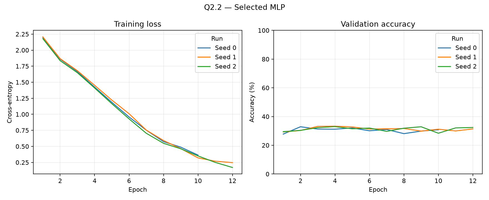

# Q2.2 — MLP

## Estado

Implementação e primeira pesquisa concluídas. A configuração foi escolhida com um run de seleção (seed 17) pela melhor accuracy de validação. Só depois foram avaliados os três runs finais no teste.

## Método

Implementámos um MLP configurável em profundidade (lista de larguras ocultas), largura, ativação (`ReLU` ou `tanh`) e dropout. Todas as experiências usam imagens achatadas e a normalização por canal calculada no treino, como na Q2.1.

A pesquisa curta comparou cinco configurações, todas com Adam (`lr=0.001`), batch size 128, máximo de 18 épocas e early stopping com paciência 5. O critério foi a melhor accuracy de validação no run de seleção. A configuração escolhida foi então treinada até 35 épocas no máximo, com paciência 8, em três seeds. O treino usa o loop fornecido, que restaura o checkpoint com melhor score de validação.

| Candidato | Camadas ocultas | Ativação | Dropout | Parâmetros | Melhor validação (seed 17) | Melhor época |
|---:|---|---|---:|---:|---:|---:|
| 1 | 256 | ReLU | 0.0 | 3 148 554 | 30.7% | 8 |
| 2 | 512 | ReLU | 0.0 | 6 297 098 | 30.3% | 2 |
| 3 | 512, 256 | ReLU | 0.0 | 6 425 866 | **32.5%** | 2 |
| 4 | 512 | tanh | 0.0 | 6 297 098 | 32.4% | 3 |
| 5 | 512 | ReLU | 0.3 | 6 297 098 | 31.7% | 5 |

Escolhemos candidato 3. A pesquisa varia profundidade, largura, ativação e dropout, mas mantém fixos optimizer, learning rate e batch size; a sua conclusão aplica-se apenas a esta grelha pequena.

## Resultados finais

Accuracy em percentagem; média e desvio-padrão amostral das três seeds.

| Seed | Melhor época | Validação | Teste |
|---:|---:|---:|---:|
| 0 | 2 | 32.9% | 28.5% |
| 1 | 4 | 33.3% | 28.3% |
| 2 | 4 | 33.0% | 28.2% |
| **Média ± desvio-padrão** | — | **33.07% ± 0.21 pp** | **28.33% ± 0.15 pp** |

Com a baseline Q2.1 atualmente selecionada (`SGD`, `lr=0.001`), o MLP melhora o teste em **1.60 pontos percentuais** (`28.33%` contra `26.73%`). Tem 6 425 866 parâmetros, cerca de 52 vezes os 122 890 da baseline. A loss de treino continua a descer depois da melhor época de validação; isso é compatível com sobreajuste neste treino, embora a accuracy de validação mantenha oscilações. A escolha do checkpoint por validação limita o efeito na métrica final.

## Curvas

## Texto de trabalho para o relatório

> Implementámos um MLP com profundidade, largura, ativação e dropout configuráveis. Selecionámos a configuração pela accuracy de validação numa pesquisa de cinco candidatos, mantendo Adam (`lr=0.001`) e batch size 128 fixos. A configuração selecionada tem duas camadas ocultas de 512 e 256 unidades, ReLU e sem dropout (6 425 866 parâmetros). Com early stopping e seleção do melhor checkpoint por validação, três seeds produziram accuracy de teste de `28.33 ± 0.15%` e accuracy de validação de `33.07 ± 0.21%`. O resultado supera a baseline linear atual (`26.73 ± 0.91%`, SGD com `lr=0.001`) em 1.60 pontos percentuais, usando aproximadamente 52 vezes mais parâmetros. As curvas mostram redução da loss de treino após o pico de validação, sugerindo sobreajuste; a generalização deve ser interpretada tendo em conta a grelha limitada de hiperparâmetros e o uso de uma única seed durante a pesquisa.

## Limitações e próximos passos

- A pesquisa usa uma única seed para selecionar a configuração; os três seeds são usados na estimativa final.
- Adam e `lr=0.001` foram fixados, não comparados nesta questão. A Q2.3 deverá estudar escolhas de desenho controladas.
- A curva de loss usa a média simples das médias por batch do loop fornecido; o último batch menor recebe o mesmo peso dos restantes.
- O texto é uma nota de trabalho para revisão, não uma resposta final aprovada.

## Artefactos

- Resultados completos e históricos por seed: [`summary.json`](summary.json).
- Curvas: [`learning_curves.png`](learning_curves.png).
- Script reproduzível: [`src/run_q2_2.py`](../../src/run_q2_2.py).
- Baseline comparada: [`results/q2_1/README.md`](../q2_1/README.md).
