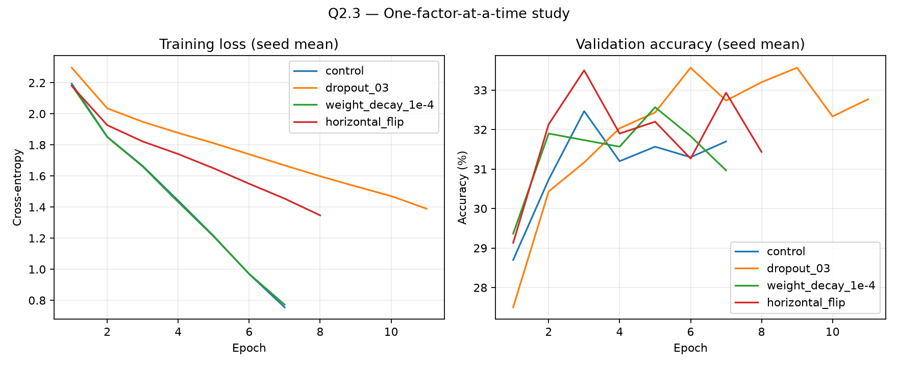
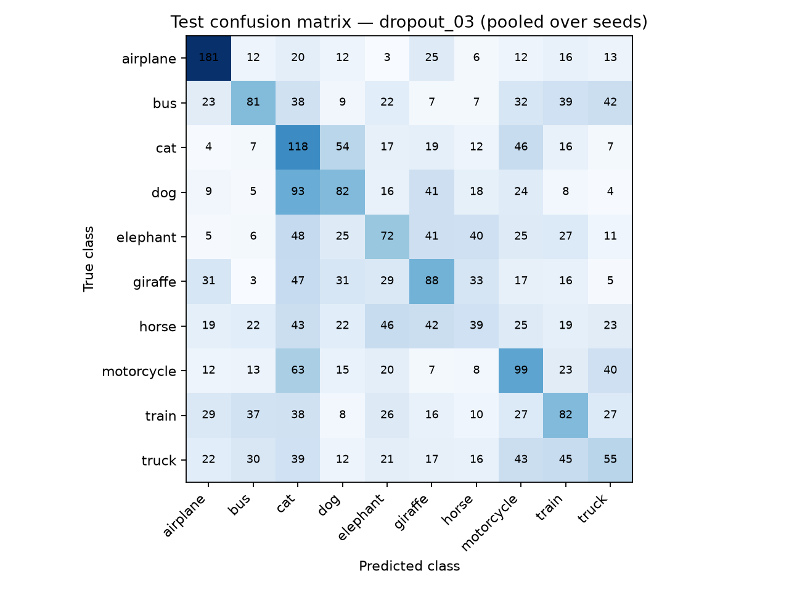

# Q2.3 — Estudo controlado do MLP

## Protocolo

Partimos da configuração selecionada na Q2.2: MLP `512 → 256 → 10`, ReLU, Adam (`lr=0.001`) e batch size 128. Mantivemos os mesmos seeds (`0, 1, 2`), a mesma divisão dos dados e o mesmo limite máximo de 18 épocas. Todas as condições usam o mesmo batch size, optimizer, learning rate e patience 5. O early stopping é aplicado separadamente a cada execução com base na accuracy de validação, guardando o melhor checkpoint. Portanto, há um limite máximo comum, mas o número efetivo de épocas e atualizações não é necessariamente igual entre condições.

Variámos uma decisão de cada vez em relação ao controlo:

1. Dropout: `0` → `0.3`.
2. Weight decay do Adam: `0` → `1e-4`.
3. Flip horizontal aleatório, apenas no treino: desligado → ligado.

As quatro configurações foram comparadas apenas pela média da accuracy de validação. Depois de selecionar dropout `0.3`, repetimos essa configuração com os mesmos três seeds e consultámos o teste para as métricas finais. Os valores são média ± desvio-padrão amostral entre seeds. Os seeds medem variação de treino; os três resultados usam os mesmos exemplos fixos de teste.

## Comparação

| Configuração | Parâmetro alterado | Accuracy treino (%) | Accuracy validação (%) | Diferença treino−validação (pp) | Melhor época média |
|---|---|---:|---:|---:|---:|
| Controlo | Nenhum | 61.83 ± 20.71 | 33.03 ± 0.12 | 28.79 ± 20.62 | 4.0 |
| Dropout | `p=0.3` | 50.15 ± 2.67 | **34.10 ± 1.42** | 16.05 ± 3.82 | 6.3 |
| Weight decay | `1e-4` | 64.06 ± 17.83 | 33.13 ± 0.76 | 30.93 ± 17.42 | 4.3 |
| Flip horizontal | probabilidade 0.5 | 40.75 ± 0.67 | 33.50 ± 0.36 | 7.25 ± 0.91 | 3.0 |

Accuracy de treino e diferença treino−validação são medidas no checkpoint de maior accuracy de validação. Reportamos média ± desvio-padrão amostral sobre os três seeds; a diferença é calculada dentro de cada seed e depois agregada. Para medir treino, usamos as imagens originais, sem augmentation, mesmo na condição com flip.

O dropout obteve a maior média de validação, mas também maior dispersão entre seeds. Os ganhos são modestos e não demonstram que estes valores sejam globalmente ótimos; a conclusão aplica-se a este MLP e a este protocolo.

## Curvas e generalização



A loss de treino diminui enquanto a accuracy de validação tende a oscilar depois de atingir o melhor checkpoint; isto é compatível com sobreajuste durante as épocas posteriores. A comparação de accuracies no checkpoint escolhido mostra uma diferença treino−validação positiva em todas as condições. Para dropout, por exemplo, é `16.05 ± 3.82` pontos percentuais, o que reforça o sinal de sobreajuste mesmo no checkpoint selecionado. O dropout reduz essa diferença face ao controlo e mantém a melhor accuracy média de validação, consistente com um efeito regularizador.

Não observamos o padrão típico de underfitting em que as accuracies de treino e validação são ambas baixas e próximas: o treino fica acima da validação em todas as condições. Isto não prova que o modelo tenha capacidade suficiente para todas as classes, mas não há evidência agregada de underfitting como problema dominante. Há elevada variação entre seeds no controlo e em weight decay. A seleção do checkpoint pela própria validação também tende a favorecer a accuracy reportada nesse split, pelo que a diferença deve ser interpretada como diagnóstico descritivo, não como estimativa imparcial de generalização. A loss de treino e a accuracy de validação são métricas diferentes; não interpretamos a distância entre elas como uma diferença quantitativa de desempenho.

## Resultado final no teste

A configuração selecionada, dropout `0.3`, obteve **29.90 ± 1.54%** de accuracy de teste (`29.5%, 31.6%, 28.6%` nos seeds 0, 1 e 2). No checkpoint selecionado, a accuracy de treino foi `50.15 ± 2.67%` e a de validação `34.10 ± 1.42%`. O modelo tem **6,425,866 parâmetros**.

| Classe | Accuracy média no teste (%) |
|---|---:|
| airplane | 60.3 ± 5.0 |
| bus | 27.0 ± 4.0 |
| cat | 39.3 ± 24.5 |
| dog | 27.3 ± 9.3 |
| elephant | 24.0 ± 3.6 |
| giraffe | 29.3 ± 2.1 |
| horse | 13.0 ± 3.6 |
| motorcycle | 33.0 ± 3.6 |
| train | 27.3 ± 8.3 |
| truck | 18.3 ± 7.5 |

O desempenho varia bastante por classe e seed: airplane tem a maior média e horse a menor nestas três execuções, mas a elevada dispersão de cat (11%–54%) mostra que esta ordenação é descritiva, não uma conclusão estável. A tabela apresenta média ± desvio-padrão amostral, calculados entre os três seeds.



A matriz apresentada soma as contagens dos três modelos avaliados nos mesmos 1.000 exemplos de teste (3.000 previsões no total); as contagens não representam um único modelo. Entre as confusões mais frequentes estão dog→cat, horse→cat, motorcycle→cat e truck→cat, compatíveis com semelhanças visuais nas imagens pequenas de 64×64.

## Reprodução e ficheiros

Executar a partir da raiz do repositório:

```bash
python src/run_q2_3.py
```

O script grava `summary.json`, `learning_curves.png` e `confusion_matrix.png` nesta pasta. O JSON contém resultados por seed, accuracies de treino no melhor checkpoint, curvas, configuração, accuracies por classe e matrizes individuais e agregada.
